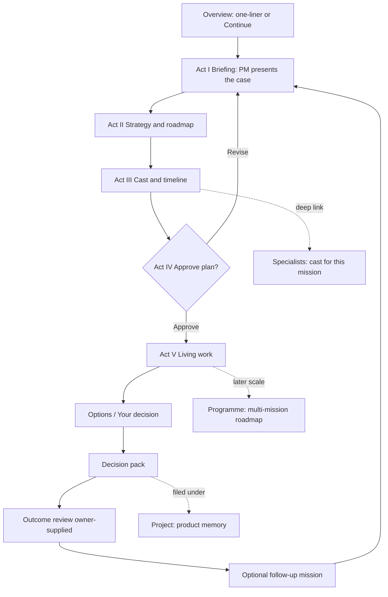

# Strategy: Briefing theatre → cast & roadmap → approve → living work

**Status:** Planning only — **do not build until founder sign-off.**  
**Date:** 27 October 2026  
**Repo:** `swift-deliveries` · Live: https://www.deliverx.dev  
**E2E reference mission:** `/command/supervised/e1a95c83-e087-402d-b91e-0455e5f0ce6e`  
**Prior plan this supersedes for UX/IA:** `docs/roadmap-one-liner-pm-brief.md` (Phases B–E shipped functionally; experience still reads as ops dashboard)

---

## 0. Executive verdict (candid)

Phases B–E delivered the *mechanics* the founder asked for (one-liner intake, PM brief object, specialist work scene, staffing bands, research-first pass). They did **not** deliver the *feel*.

What ships today is still a **Command Centre ops console**: stacked panels, honesty-gap walls of text, progress steppers, usage meters, CRUD forms, catalogue browsers, and KPI strips. The initiating PM “Here’s what I heard” is present — then immediately flattened into definition lists, research-mode buttons, and “Available Wave 1 / Band M” ops copy.

The founder’s desired arc is **not** “improve the dashboard.” It is a **product investigation briefing** that then becomes a **staffed programme of work**:

1. AI technology briefing (PM/agent presents the case)  
2. Strategy and roadmap  
3. Who delivers what, and how long  
4. Approval  
5. Work continues visibly  

Specialists / Project / Programme pages were left as **side rooms with different jobs** (catalogue, empty containers, long forms + KPI dashboard). That is why it feels like you are “stuck in overview.”

**Do not build UI or product code from this document until the founder chooses an option and signs the open decisions.**

---

## 1. What each surface is today vs what it should be

Inspected in code + signed-in live UI (27 Oct 2026).

### 1.1 Overview — `/command`

| | Today | Founder want |
| --- | --- | --- |
| **One job** | Catch-all workspace home | Entrance: start or resume a case; nothing else competes |
| **What you see** | Emergency stop → Owner inbox → Talk to DeliverX (classification dumps + “Understood: I won't”) → attention queue → metrics → mission list → one-liner form → collapsed advanced planner + agents office | Quiet foyer → one product question → handoff into briefing theatre |
| **Failure** | Dashboard of unrelated honesty systems. Primary CTA buried. Subtitle is a process pipeline (`objective → evidence → options…`). | Not a briefing. Not a cast. Not a roadmap. |

**Live tell:** First viewport is “Waiting on you” + chat transcript with `Source: Founder-provided… Classification: User-provided assertion…` — compliance theatre, not technology briefing.

### 1.2 Supervised mission — `/command/supervised/:id`

| | Today | Founder want |
| --- | --- | --- |
| **One job** | Persist and operate the decision loop | Briefing → strategy/roadmap → cast & timeline → gate → living work |
| **What you see** | 6-step “Done · Objective…” grid → PM brief (good seed) as panel + `<dl>` meta → Work scene chips + task ownership graph → Research mode toggles → usage/attempts → evidence editors → conversation again → outcome forms | Sequential **acts**, not a scroll of panels |
| **Failure** | Even the completed coworking E2E mission reads as an **ops ledger**. Work scene admits “band M / Available team / not a fake timer.” Honesty and research gaps dominate the narrative. | Still “stuck in overview energy” inside the mission |

**Live tell (E2E):** Progress is all “Done · …”; PM plan is process bullets (“Problem-Framing Agent restates…”); staffing is “6 Available Wave 1 specialists (Band M — Standard (~20–50 catalogue intent))”; findings are gap-labelled honesty — correct, but presented as admin status, not as a PM presenting a case.

### 1.3 Specialists — `/command/capabilities`

| | Today | Founder want |
| --- | --- | --- |
| **One job** | Browse 150-role catalogue / org graph | See **who is on this case** (and optionally explore the wider bench) |
| **What you see** | “Your specialist network” · 150 catalogue / 8 available · department list · radial workforce architecture · role inspector (Inputs/Outputs/Limitations) | Delivery cast: role, contribution, status, ETA; catalogue secondary |
| **Failure** | HR org chart for a product that claims staffed investigation. Mission context often “Catalogue · no task mission selected.” | Answers “who exists?” not “who is delivering *my* work?” |

Prior roadmap explicitly **deferred agents office as primary**. That was right for intake — wrong if Specialists remains forever a disconnected catalogue while Overview carries the only story.

### 1.4 Projects — `/command/projects`

| | Today | Founder want |
| --- | --- | --- |
| **One job** | CRUD `wf_projects` containers for legacy Investigate/Prototype/Improve | The **product** you are building: memory, missions, decisions, next steps |
| **What you see** | Name + description form; empty list; links to Product memory / New mission | Project home: question → decisions → artefacts → open work |
| **Failure** | Dead room. Supervised primary path barely needs it. Subtitle still names legacy intents. | Founder asks “what about project?” — today there is almost nothing to defend |

### 1.5 Programmes — `/command/programmes` (+ `/$programmeId`)

| | Today | Founder want |
| --- | --- | --- |
| **One job** | Separate long-horizon PSI simulation with server-step advance | Strategy + roadmap + cast at programme scale (or clearly demoted) |
| **What you see** | Intake: name, users, idea, problem, goals, constraints, weeks, credits — questionnaire. Detail: FounderBriefing Q&A → **KPI strip** (Progress %, Workforce /150, Decisions, Meetings) → RoadmapTimeline → tabs (Work plan, Decisions, Meetings…) → **“Run next server step”** | Same narrative arc as mission, scaled; not a second product |
| **Failure** | Second product with form-first intake and ops dashboard. Competes with supervised loop for “what is DeliverX?” | Exactly the dashboard feel the founder rejects |

### 1.6 Shell / nav

`CommandShell` labels Overview with a **LayoutDashboard** icon, breadcrumb `Workspace / …`, usage progress bars, “Human supervised” chip, `+ New mission`. Specialists uses a separate network chrome. The chrome itself signals **ops dashboard**, not briefing theatre.

---

## 2. Why it feels like a dashboard (root causes)

1. **Composition = stacked panels** (`cc-panel` everywhere). Briefing is one panel among many, not the stage.  
2. **Honesty is foreground narrative.** Correct policy, wrong placement: classification dumps and “provider not configured” own the first read. Honesty should be **labels and footnotes**, not the plot.  
3. **Process language wins over case language.** “Saved stage: evidence · Compare options · 0 usage units”, “Band M”, “Available Wave 1”, “Run next server step”, “Task ownership graph”.  
4. **Forms before story.** Overview chat, programme intake, evidence editors, outcome review — all shout “fill me.”  
5. **IA is a nav of tools, not a journey.** Overview / Specialists / Projects / Programmes are four apps sharing a sidebar.  
6. **Living work is a chip strip + graph**, not a scene with ownership and time. Phase C shipped “practical” living scene; it still looks like a status widget.  
7. **Two (three) intake paths.** Supervised one-liner, ConversationPanel, Advanced mission planner, Programme form — founder never gets one theatre.  
8. **Phase B–E optimized the happy-path object model**, then wrapped it in the old shell. Functional win; experiential miss.

---

## 3. North-star experience narrative

**DeliverX is not a command dashboard. It is a supervised AI product investigation you attend.**

### Act I — Technology briefing
You give a one-liner. An initiating PM agent takes the stage and presents: what the case is, what is known vs unknown, what kind of investigation this is, and why specialists are the right tool. Tone: calm, editorial, confident. Honesty as discreet badges (“Simulated draft”, “Web not configured — gaps labelled”), never as the opening paragraph.

### Act II — Strategy and roadmap
Same agent (or Chief of Staff) shows the proposed approach as a **roadmap of beats**, not a lifecycle pipeline tattoo. Beats are in product language: Frame · Research · Options · Your decision · Pack · Learn. Time bands in human terms.

### Act III — Cast and timeline
Who delivers what, for how long. Named roles with one-line contribution and ETA/band. Human gates marked as **you**. Catalogue intent (20–150) is a quiet honesty label under the active cast — not the headline.

### Act IV — Approval
One clear human gate: approve this plan (or revise). Nothing billable or external moves without it. Secondary honesty: what will / will not run (web, model, customer contact).

### Act V — Living work
After approval, the same stage becomes a **living work view**: specialists advance on persisted events; findings and gaps appear as the investigation unfolds; next human action is a single focal CTA. No fake timers. No invented research.

**Overview’s job** is only to get you into Act I (or resume the current act). **Specialists / Project / Programme** deepen Acts II–V at the right zoom — they are not alternate homes.

---

## 4. Information architecture (one job per page)

### Proposed primary spine

```
One-liner (Overview or empty state)
    → Briefing theatre (mission Acts I–IV)
        → Living work (Act V on same mission URL, staged UI)
            → Decision pack / outcome
                → optional Follow-up (new mission, same Project)
```

### Page jobs (binding)

| Surface | ONE job | Owns | Does not own |
| --- | --- | --- | --- |
| **Overview** | Start or resume | One CTA + short resume list (max ~3) | Chat dumps, metrics walls, advanced planner, agents office, emergency stop as hero |
| **Mission (supervised)** | Run the five-act investigation | Briefing, roadmap, cast, approve, living work, pack | Catalogue browsing, programme KPIs, project CRUD |
| **Specialists** | Cast & bench for the **active** context | Who’s on this case; contribution; status; deep-link to role | Primary intake; 150-role tourism as default |
| **Project** | Product memory home | Related missions, decisions, packs, open questions | Intake forms; org chart |
| **Programme** | Multi-mission strategy (later / demoted) | Roadmap across missions; portfolio gates | Competing form-first entry; server-step ops UI as hero |

### What moves

| From | To |
| --- | --- |
| Overview attention queue + metrics | Compact “Continue” strip only |
| Mission progress grid + meta `<dl>` | Act-based stages (Briefing / Roadmap / Cast / Approve / Work) |
| Work scene chips | Cast board with ownership + time (same honesty rules) |
| Specialists catalogue-first | Context-first cast; catalogue under “Explore the bench” |
| Projects empty CRUD | Project as timeline of missions + artefacts |
| Programme intake questionnaire | Same one-liner → briefing path, or hide until Phase later |
| ConversationPanel on Overview | Demote to optional / mission-scoped revise, not home hero |
| Honesty walls | Inline badges + expandable “How this was produced” |

### What dies or demotes (until re-approved)

| Item | Recommendation |
| --- | --- |
| Advanced mission planner on Overview | Stay collapsed; demote further or move under Project |
| Agents office on Overview | Keep deferred; do not promote |
| Programme as parallel primary | Demote in nav or label “Lab / long-horizon” until briefing IA lands on supervised |
| KPI strip as programme hero | Demote below briefing / roadmap |
| “Run next server step” as primary CTA | Replace with human-language next action (implementation later) |
| LayoutDashboard framing | Rename/reskin shell away from “dashboard” metaphor |
| Dual shell (network vs command) | Unify chrome; Specialists should feel like same product |

---

## 5. Visual / UX principles

1. **Briefing vs dashboard**  
   - Briefing: one composition, narrative hierarchy, long-form readable type, stage/focus.  
   - Dashboard: panels, filters, KPI cards, equal-weight widgets. **Prefer briefing on primary spine.**

2. **AI vs human clarity**  
   - Agent contributions: “Specialist draft · model X / simulated”.  
   - Human: “Your decision”, “Owner-supplied observation”.  
   - Never blur into generic “Verified”.

3. **Movie-scene / living work without fake theatre**  
   - Motion only from **persisted events**.  
   - If nothing happened, the scene is still — labelled ready/waiting, not “busy”.  
   - No synthetic interviews as evidence; rehearsal content marked.

4. **Honesty without killing the story**  
   - Default read: the case.  
   - Secondary: gaps, provider missing, simulated.  
   - Forbidden as hero copy: classification essays, migration codes, lease/attempt counters (operator fold only).

5. **One focal next action**  
   Every screen has one primary button that advances the arc. Everything else is secondary.

6. **Keep the homepage visual foundation** for marketing; Command can shift to editorial briefing without purple-dashboard cliché — but do not redesign marketing in this workstream.

---

## 6. Flow diagram (beats)



---

## 7. Options (2–3) with tradeoffs

### Option 1 — Reskin the supervised mission only (“Theatre on the existing URL”)
Rebuild Acts I–V inside `/command/supervised/:id`; strip Overview to start/resume; leave Specialists/Projects/Programmes mostly as-is for a later pass.

- **Pros:** Fastest demo of the arc; reuses Phase B–E objects; lowest schema risk.  
- **Cons:** Nav still feels like four products; Specialists/Project/Programme dissatisfaction remains.  
- **Risk:** Founder still asks “what about the other pages?”

### Option 2 — Unified briefing IA across Overview + Mission + Specialists + Project (**recommended**)
One narrative system. Overview = foyer. Mission = theatre. Specialists = cast for active mission (catalogue secondary). Project = memory shelf. Programme demoted or labelled Lab until it shares the same briefing language.

- **Pros:** Answers the founder complaint directly; one mental model; clears competing intakes.  
- **Cons:** Larger UX scope; needs hard demotion decisions; programme path may feel “sidelined.”  
- **Risk:** Temptation to rebuild programme at the same time — resist.

### Option 3 — New “Case” primary with Programme as the long form
Introduce `/command/cases/:id` as the briefing theatre; supervised becomes an implementation detail; programmes merge into cases later.

- **Pros:** Clean break from dashboard shell.  
- **Cons:** Route fork contradicts prior “no `/cases` fork” decision (Option C Hybrid); higher migration/confusion cost; more build before proof.  
- **Risk:** History rewrite of user mental model + Lovable sync churn.

---

## 8. Recommended option

**Recommend Option 2.**

Why: Phase B–E already bet on supervised as the spine. The gap is **experience and IA**, not a new entity. Option 1 under-answers the founder. Option 3 reopens a closed architectural decision without evidence that a new route is required.

**Binding for Option 2:**

- Supervised mission remains the primary investigation URL.  
- Overview is foyer only.  
- Specialists default to **active cast**; catalogue is Explore.  
- Project becomes the shelf for related work.  
- Programme stays available but **not** the primary story until it speaks the same acts (or stays Lab).

---

## 9. Phased roadmap (planning — no build yet)

| Phase | Outcome | Demo criteria (founder can click) | Depends on |
| --- | --- | --- | --- |
| **G0 — Experience contract** | This doc signed; option + open decisions closed | Written approval in chat/doc | Founder |
| **G1 — Mission theatre** | Acts I–V on supervised URL; one focal CTA; honesty demoted | One-liner → briefing → roadmap → cast → approve → living findings without ops hero chrome | G0; existing PM brief + team + activity events |
| **G2 — Overview foyer** | Start/resume only; chat/metrics/advanced demoted | First viewport has no honesty essay, no KPI wall | G1 patterns |
| **G3 — Specialists as cast** | Active mission cast primary; catalogue secondary | From mission, Specialists shows the 4–8 on the plan with contribution lines | G1 cast model |
| **G4 — Project as memory** | Project page lists missions, decisions, packs | Empty CRUD replaced by shelf for at least one real project | Supervised ↔ project linkage clarity |
| **G5 — Programme alignment or Lab label** | Either same acts language or explicit Lab demotion | Founder no longer confuses programme form with primary path | G1–G4 stable |
| **F — Voice** | Still deferred after typed theatre works | — | G1 |

Prior A–E remain historical delivery; **G\*** is the experience track. Do not claim B–E “done” as the briefing product.

### Dependencies (non-UI)

- Honesty/disclosure rules stay; only presentation changes.  
- No invented research; web only when configured.  
- Human-only gates.  
- Additive persistence; no legacy Delivery-OS mutation.  
- Prefer restyling existing mission document fields before new tables.

---

## 10. Open decisions for founder approval

1. **Option 1 vs 2 vs 3?** (Recommendation: **2**)  
2. **Programme:** demote to Lab in nav now, or keep peer nav but freeze feature work?  
3. **ConversationPanel on Overview:** remove from home, mission-only, or keep but collapsed?  
4. **Specialists default:** always require an active mission context, or allow catalogue with empty-state CTA into one-liner?  
5. **Project linkage:** auto-create a project per supervised mission family, or lazy attach at pack export?  
6. **Shell metaphor:** keep “Command Centre / Product workspace” naming, or rename to something less ops (e.g. “Workspace” / “Investigations”)?  
7. **Demo mission for G1:** reuse coworking E2E, or a fresh one-liner with web provider on so Act V shows findings not only gaps?

---

## 11. Explicit: do not build yet / what NOT to change

Until G0 sign-off:

- **Do not** implement Act UI, reskins, nav renames, or programme demotion in code.  
- **Do not** commit or push from this planning work.  
- **Do not** add migrations for “briefing” entities.  
- **Do not** expand the 150-role catalogue UX.  
- **Do not** promote agents office or voice.  
- **Do not** merge programme and supervised into one schema.  
- **Do not** rewrite `docs/roadmap-one-liner-pm-brief.md` as “done experience.”  
- **Do not** force-push or rebase Lovable-connected history.

Safe meanwhile: keep using the live supervised path for evidence; treat honesty gaps as product truth, not UX failure of the honesty policy itself.

---

## 12. One-line ask to the founder

Approve **Option 2** (and the open decisions above) so the next build is a **briefing theatre on the supervised spine**, with Specialists/Project as cast and memory — not another pass at making the ops dashboard prettier.
